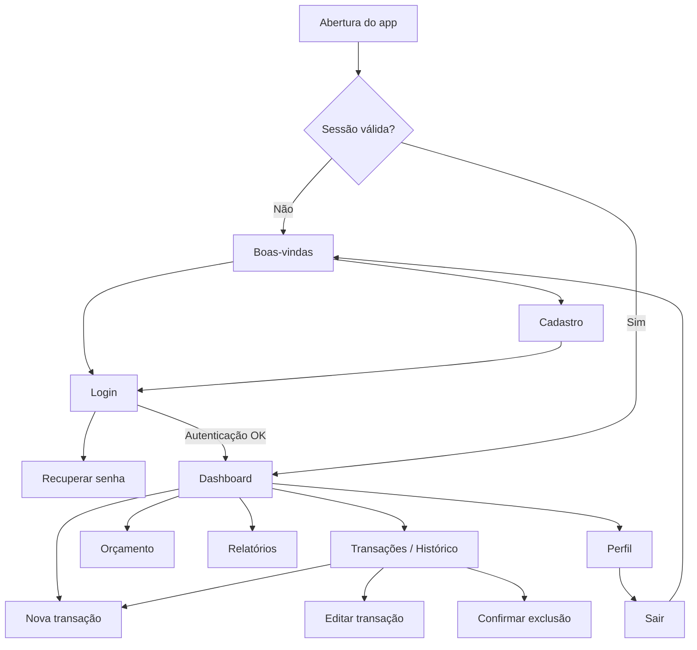

# BolsoZen — 03. Jornadas e fluxos de navegação

**Versão:** 1.0  
**Objetivo:** descrever como o usuário se desloca entre as telas e quais estados precisam existir além dos mockups estáticos.  
**Referência visual:** prancha BolsoZen de oito telas, fornecida junto ao projeto na pasta `design/telas/`.

## 1. Mapa de navegação

Após autenticação, barra inferior fixa nas telas principais: **Início**, **Transações**, **Orçamento**, **Relatórios**, **Perfil**. Formulários como Nova transação e Editar transação são rotas secundárias, sem duplicar necessariamente a barra inferior.

## 2. Jornada J-01 — Primeiro acesso e cadastro

**Pré-condição:** usuário sem sessão autenticada.

1. Abre o aplicativo e visualiza a tela Boas-vindas.
2. Toca em **Criar conta**.
3. Visualiza campos Nome, E-mail, Senha e Confirmar senha.
4. Preenche os campos e confirma os termos, se houver textos reais publicados.
5. Toca em **Criar conta**.
6. App valida campos localmente e chama Firebase Authentication.
7. Se houver sucesso, salva perfil mínimo e navega ao Dashboard (sem conteúdo fictício).
8. Se houver erro, mantém o formulário e apresenta mensagem clara sem revelar informações sensíveis.

**Variações:** e-mail inválido, senha curta, senhas diferentes, e-mail já cadastrado, indisponibilidade do Firebase, falha parcial de criação de perfil. Duplicar toque não pode gerar vários envios simultâneos.

## 3. Jornada J-02 — Login e recuperação

1. Na tela Boas-vindas, toca em **Entrar**.
2. Informa e-mail e senha.
3. Toca em **Entrar**; botão entra em carregamento.
4. Em sucesso, abre Dashboard.
5. Em erro, mostra mensagem amigável e permite tentar novamente.
6. Ao tocar em **Esqueci minha senha**, abre fluxo simples para informar e-mail e solicitar o envio de recuperação.

**Persistência:** ao reiniciar o aplicativo, Firebase verifica a sessão. Usuário autenticado entra direto na área principal; usuário deslogado volta à área pública. A interface deve exibir um estado inicial de carregamento para evitar piscar login antes do dashboard.

## 4. Jornada J-03 — Visualizar finanças no Dashboard

**Pré-condição:** usuário autenticado.

1. Abre Início e vê saudação com nome do usuário.
2. Visualiza **Saldo total** calculado de todo o histórico.
3. Visualiza **Receitas** e **Despesas** do mês de referência e indicador de orçamento, se houver limites.
4. Vê gráfico/linhas de gastos por categoria com percentuais.
5. Visualiza transações recentes.
6. Toca no ícone de olho para ocultar/exibir o saldo.
7. Toca em **Ver mais** ou **Ver todas** para navegar à seção correspondente.
8. Toca no botão **+** para criar uma transação.

**Estado vazio:** saldo R$ 0,00, receitas/despesas R$ 0,00, indicação “Nenhuma transação ainda”, CTA “Adicionar transação”; categorias e orçamento sem barras fictícias. **Estado erro:** oferecer ação de tentar novamente.

## 5. Jornada J-04 — Lançar receita ou despesa

1. No Dashboard ou Histórico, toca em **+** ou “Adicionar transação”.
2. Escolhe **Receita** ou **Despesa** (padrão pode ser Despesa, documentado no código).
3. Informa valor maior que zero, categoria compatível, data e descrição.
4. Visualiza “Conta principal” como informação fixa.
5. Toca em **Salvar transação**.
6. App valida e cria documento em `users/{uid}/transactions`.
7. Exibe sucesso e retorna à tela de origem ou à lista de transações.
8. Dashboard, Histórico, Orçamento e Relatórios passam a refletir o novo registro.

**Erros relevantes:** valor inválido, campo vazio, falha de conexão, gravação negada, toque duplo, data inválida. O formulário deve continuar preenchido em caso de erro de gravação. Ao trocar Receita/Despesa, ajustar categorias disponíveis; limpar categoria incompatível.

## 6. Jornada J-05 — Consultar, editar e excluir transação

1. Entra em **Transações** pelo menu inferior.
2. Lista aparece agrupada por data, ordenada da mais recente para a mais antiga.
3. Usa busca textual ou chips **Todas**, **Receitas**, **Despesas**.
4. Seleciona uma transação e escolhe **Editar** ou **Excluir** (ex.: tela de detalhe simples, menu contextual ou bottom sheet).
5. Na edição, formulário vem preenchido e permite salvar alterações.
6. Na exclusão, app pede confirmação com descrição e valor.
7. Após salvar/excluir, a lista e todos os totais dependentes são recalculados.

**Estado vazio de filtro:** “Nenhuma transação encontrada”, com opção de limpar filtros. Exclusão cancelada não modifica dados. Falha na exclusão não remove o item visualmente como operação concluída.

## 7. Jornada J-06 — Criar e acompanhar orçamento mensal

1. Entra em **Orçamento**.
2. Tela inicia no mês corrente e permite navegar por mês/ano.
3. Sem limites, exibe orientação e botão **Definir limites**.
4. Ao selecionar **Editar limites**, visualiza as categorias de despesa e campo de valor máximo para cada categoria.
5. Salva os limites do mês selecionado.
6. Tela mostra para cada categoria **gasto**, **limite** e **% consumido**.
7. Quando passa de 80%, mostra aviso contextual; a partir de 100%, alerta de limite atingido/ultrapassado.
8. Pode remover limite sem alterar transações passadas.

**Importante:** o alerta de 90% de Alimentação mostrado no protótipo é ilustrativo. Só aparecerá quando o percentual real da categoria atender à regra.

## 8. Jornada J-07 — Consultar relatórios

1. Entra em **Relatórios** pelo menu inferior.
2. Visualiza o mês de referência, total de despesas e comparação com mês anterior.
3. Consulta evolução dos gastos nos últimos meses via linha/colunas.
4. Consulta participação das categorias de despesas via gráfico de rosca ou lista acessível.
5. Alterna entre **Visão geral**, **Categorias** e **Evolução**, se as três abas estiverem implementadas.

**Sem dados:** mostrar orientação, estado neutro do gráfico e nenhum percentual fabricado. Para comparação com mês anterior igual a zero, mostrar “Sem base de comparação”.

## 9. Jornada J-08 — Perfil e logout

1. Entra em **Perfil** pela barra inferior (tela complementar, não desenhada integralmente na prancha).
2. Visualiza nome e e-mail associados à conta autenticada.
3. Toca em **Sair** e confirma, se necessário.
4. Firebase encerra a sessão; rotas privadas ficam inacessíveis.
5. Usuário retorna à tela Boas-vindas/Login.

Não incluir edição de avatar, alteração de senha dentro do app, exclusão de conta ou configurações avançadas como critérios do MVP.

## 10. Estados transversais de UX

| Estado | Comportamento esperado |
|---|---|
| Carregando | Indicador de progresso em área apropriada; evitar tela em branco sem feedback |
| Sucesso | Snackbar ou mensagem curta e retorno consistente à origem |
| Erro de rede | Mensagem amigável, ação de tentar novamente, sem apagar dados digitados |
| Sem dados | Ilustração/ícone leve, texto explicativo e CTA útil |
| Sem resultados de busca | Informação clara e ação de limpar filtros |
| Permissão negada | Mensagem genérica segura; não exibir dados privados |
| Envio repetido | Bloquear botão enquanto requisição está pendente |
| Teclado aberto | Rolar conteúdo, mantendo ações acessíveis sem overflow |
| Voltar do Android | Respeitar pilha de navegação; não duplicar páginas nem voltar ao login com sessão válida |

## 11. Matriz de rotas e ações

| Origem | Ação | Destino / resultado |
|---|---|---|
| Boas-vindas | Entrar | Login |
| Boas-vindas | Criar conta | Cadastro |
| Login | Esqueci minha senha | Recuperação por e-mail |
| Login | Criar conta | Cadastro |
| Cadastro | Já tenho conta | Login |
| Login/Cadastro | Autenticação bem-sucedida | Dashboard |
| Dashboard | + | Nova transação |
| Dashboard | Ver todas | Transações |
| Dashboard | Ver mais (categorias) | Orçamento ou Relatórios/Categorias, conforme contexto identificado |
| Transações | Selecionar item | Ações Editar / Excluir |
| Orçamento | Editar limites | Edição dos limites do mês selecionado |
| Menu inferior | Item | Tela principal correspondente |
| Perfil | Sair | Boas-vindas/Login |

## 12. Critérios de revisão de fluxo

- Nenhum botão importante da referência visual deve ficar sem ação ou usar um link simulado.
- Todas as telas privadas exigem usuário autenticado.
- Operações assíncronas possuem feedback e tratamento de falhas.
- Não existem transações, limites ou gráficos artificiais para usuários reais.
- Navegação entre abas preserva expectativas básicas de retorno e contexto.
- O nome do usuário é carregado do perfil real, sem texto fixo “Arthur”.
