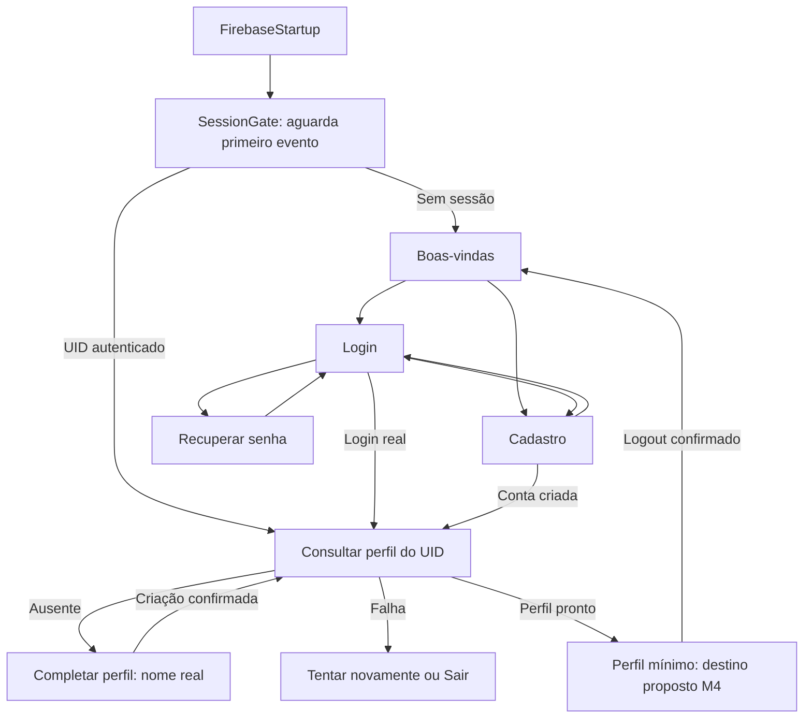

# M4 — Planejamento da autenticação completa

Status: **M4 encerrado e aprovado pelo usuário com ressalvas documentadas**, por autorização explícita após revisão funcional/visual. Login, cadastro, recuperação, perfil mínimo/conclusão de perfil, sessão e proteção de navegação implementados. Safari aprovado manualmente, incluindo recebimento/redefinição por e-mail e persistência após reabertura/reload. Android compilado e executado. M5 ainda não autorizado para implementação; Perfil mínimo permanece destino privado até sua substituição pelo Dashboard no M5. Base M3: commit e34c884ed79cf041e5371c997dde7cd93cd9abad, branch main. Android principal; Web complementar; pt-BR. Registros de autorização/resultados abaixo são históricos.

## Decisão de encerramento e transferência para M9

Aceite baseado nas entregas M4.1–M4.5 aprovadas, 301 testes Flutter aprovados, integração local Dart/FlutterFire de 19 verificações aprovada no M4.5 e validação manual Safari do usuário. Não declarar concluída a bateria Chrome M4.6: 3 verificações confirmadas, quarta aprovação invalidada e OOM continuam registrados. Não foram repetidos testes neste encerramento.

Transferidas expressamente à homologação final M9: persistência autenticada após reinício real do Android e roteiro nativo de perfil/logout/Voltar; completar a automação Chrome em origem fixa após OOM; teclado virtual/TalkBack e acessibilidade manual; revisão dos 20 informes de depreciação sem ocultá-los. Backlog oficial em [PLANO.md](PLANO.md), evidências/limites em [M4_HOMOLOGACAO.md](M4_HOMOLOGACAO.md). Essas ressalvas foram aceitas pelo usuário e não bloqueiam mais o encerramento do M4. Qualquer teste remoto ou nova tentativa pesada continua sujeito às autorizações aplicáveis.

Autorizado apenas commit local das alterações M4 e documentação de encerramento; sem push/deploy. A preparação do M5 limita-se à leitura e resumo do escopo original. Não implementar Dashboard/transações nesta tarefa. Google Login e BolsoZen Bot permanecem fora do MVP.

## Atualização de homologação — M4.6

Relatório e roteiro de pendências em [M4_HOMOLOGACAO.md](M4_HOMOLOGACAO.md); andamento em [PROGRESSO.md](PROGRESSO.md).

- Android normal lib/main.dart: uma compilação aprovada em 33 s; instalação streaming bloqueada e instalação sem streaming do mesmo APK aprovada, preservando dados. Bootstrap/boas-vindas, login/cadastro/recuperação públicos, foco/entrada ilustrativa e reabertura real **sem sessão** confirmados. Autenticação privada/reinício autenticado Android não executados sem conta remota autorizada. Teclado virtual/TalkBack pendentes.
- Chrome UI real nos emuladores demo-bolsozen, origem fixa localhost:7366: três verificações confirmadas; bateria interrompida por falta de memória nativa do Java/Firestore. Uma quarta aprovação bruta foi invalidada após inspeção: nome no formulário não prova perfil. Asserção corrigida e seis testes Node puros aprovados; sem repetir operação pesada após OOM. Reload autenticado/histórico/fluxos restantes Chrome ainda não homologados.
- Qualidade: format 68 arquivos aprovado; 301 testes Flutter aprovados; analyzer 0 erros/warnings e 20 informes. Dos 22 iniciais, 10 eram M3 e 12 M4; duas trocas seguras de import removeram dois M3. Restam 8 preexistentes + 12 M4, sem supressão ou novas dependências. Diff check aprovado.
- Aprovação Safari é evidência manual do usuário e inclui entrega/redefinição efetiva e persistência depois de reabertura/reload. Não é substituída nem extrapolada para Android/Chrome.
- Nenhuma nova funcionalidade, redesenho, mudança Gradle/Firebase/regras/índices/dependências, operação remota de criação, e-mail real pelo agente, uso A/B/C, exclusão de dados, deploy, commit ou push.

M4 continua aberto para revisão. Nova tentativa pesada após OOM e qualquer roteiro remoto exigem autorização própria. Preferir testes locais após avaliação de recursos; para Android autenticado, propor validação manual pelo usuário ou conta descartável específica sem senha no chat. Não considerar os 19 checks M4.5/77 testes M3 como executados novamente nesta homologação. Não avançar automaticamente para M5.

## Atualização de execução — M4.5

Cadastro TEL-03 e Completar perfil implementados com os componentes M4.4. Boas-vindas abre ambos os fluxos reais; Login/Cadastro alternam dentro de uma única rota, sem pilhas duplicadas. Sucesso continua dirigido pelo SessionGate após identidade e perfil confirmados. Ausência confirmada pede nome/e-mail somente leitura, sem senha, criação de segunda conta ou nome derivado do e-mail. Cadastro parcial oferece retry do perfil, não novo signUp; erro de dados/permissão permanece erro explícito. Perfis existentes e createdAt são preservados pela implementação idempotente já existente. Sem termos/links fictícios, como previsto.

Validação: 301 testes locais aprovados (269 anteriores + 32 novos); format de 67 arquivos aprovado, analyzer 0 erros/warnings e 22 informes de depreciação, diff check aprovado. SDKs FlutterFire reais em Auth/Firestore demo-bolsozen locais: 19 verificações aprovadas, incluindo sete novas de coordenação de cadastro/conclusão/idempotência e logout. Seis screenshots reais no Chrome em 360/390/412 dp, sem OOM e com fixtures identificadas. Nenhuma operação Firebase remota, conta A/B/C, alteração de regras/índices/Gradle/dependências, build Android, deploy ou commit.

Arquivos e limites em [PROGRESSO.md](PROGRESSO.md); imagens e diferenças em [M4_5_VALIDACAO_VISUAL.md](M4_5_VALIDACAO_VISUAL.md). A aprovação visual M4.4 é uma decisão do usuário posterior ao relatório histórico abaixo, cujo OOM/limites de testes continuam documentados. M4.5 aguarda revisão própria. Reinício real Android, teclado nativo/acessibilidade, persistência de navegador e entrega manual de recuperação permanecem no roteiro M4.6 ainda não autorizado. Não avançar automaticamente.

## Atualização de execução — M4.4

M4.1, M4.2 e M4.3 foram revisados e aprovados. O usuário autorizou exclusivamente M4.4; M4.5 e posteriores continuam sujeitos a nova autorização. As descrições anteriores de etapas ainda não autorizadas são registros históricos do planejamento.

M4.4 implementa login, recuperação e Perfil mínimo real, com composição de produção via FirebaseStartup/AppDependencies/SessionGate. Entrar abre login; Criar conta mantém aviso sem cadastro. Perfil ausente permite saída segura, sem criação automática ou tela Completar perfil. O gate preserva o formulário público durante autenticação e só abre o destino privado após confirmação do perfil correspondente. O destino Perfil aprovado continua vigente até M5.

Resultado local: 269 testes aprovados (228 anteriores + 41 novos), formatação aprovada, analyzer com 0 erros/warnings e 20 informes de depreciação Material (10 anteriores e 10 novos), diff check aprovado. Dez screenshots reais de preview Flutter com fakes locais foram capturadas nas larguras 360/390/412 dp. Nenhuma operação Firebase remota nesta etapa. Homologação visual integral pendente: OOM das ferramentas Dart interrompeu capturas adicionais; não houve repetição de compilação após a falha. Android/teclado nativo ainda requerem validação visual futura. Detalhes, diferenças e evidências em [PROGRESSO.md](PROGRESSO.md) e [M4_4_VALIDACAO_VISUAL.md](M4_4_VALIDACAO_VISUAL.md).

## 1. Fontes e limites

Consultados AGENTS.md, PLANO.md, PROGRESSO.md, documentos 01 a 05, protótipo design/telas/bolsozen_prototipo.png e código existente de tema, boas-vindas, Firebase e perfil. Fontes funcionais: RF-01 a RF-07, CA-01 a CA-03, J-01/J-02/J-08; CA-10/CA-11 e falhas de CA-12 aplicáveis à autenticação. Referências visuais: TEL-02/TEL-03; TEL-09/TEL-10 complementares documentadas.

Incluído no futuro M4: login, cadastro, recuperação por e-mail, sessão persistente, navegação protegida, obtenção/criação/recomposição de perfil mínimo e logout. Excluídos: dashboard, indicadores, acesso financeiro, navegação inferior com áreas ainda inexistentes, Google, verificação obrigatória de e-mail, edição de conta/avatar, troca de senha dentro do app e exclusão de conta. Não criar novos serviços, alterar regras/índices, instalar dependências ou usar credenciais administrativas.

### Decisão de navegação aprovada

CA-02 e J-01/J-02 indicam Dashboard após autenticação; PLANO.md e a autorização atual reservam Dashboard ao M5. Proposta incremental: no M4, acessar diretamente a tela **Perfil mínimo**, funcional, autenticada, com nome, e-mail e Sair. Não criar dashboard provisório, totais zerados, páginas falsas ou abas desabilitadas. No M5, o destino passará ao Dashboard e o Perfil integrará a navegação planejada.

Adaptação explicitamente aprovada pelo usuário ao autorizar M4.1. O destino privado temporário será o Perfil real, sem dashboard provisório; requisitos-base permanecem preservados e o trecho de CA-02 que exige Dashboard será validado no M5. A implementação da navegação pertence às subetapas posteriores, não ao M4.1.

## 2. Diagnóstico e reutilização

| Existe no M3 | Reutilização no M4 |
|---|---|
| FirebaseStartup e main.dart | Inicializar Firebase antes de construir dependências/session gate; manter erro explícito e retry |
| firebase_options.dart, google-services.json | Apps Android/Web existentes no projeto bolsozen-f2f35, sem reconfiguração |
| FirebaseSession | UID sempre da sessão real; verify impede aceitar resultado de outra sessão |
| UserRepository / FirestoreUserRepository | fetch com Source.server; ensureProfile idempotente com timestamps do servidor |
| UserProfile / FirestoreMappers | Modelo e validação do perfil, sem campos adicionais no Firestore |
| DataFailure / guardData | Falhas do perfil/rede/permissão; não duplicar tratamento existente |
| AppTheme, AppColors, AppSpacing e AppRadii | Roboto e Material 3, botões, campos e cartões já definidos |
| WelcomeScreen | Preservar logo grande e carrossel; substituir mensagens provisórias por callbacks de navegação reais |

No diagnóstico inicial AuthRepository ainda não existia no código. Seu contrato foi criado no M4.1 autorizado, junto de AuthUser, AuthFailure e AuthValidation, sem dependências Firebase; adaptador Firebase continua reservado ao M4.2. Não atribuir implementação prévia ao M2. Dependências firebase_core, firebase_auth, cloud_firestore, flutter_localizations e integration_test já estão disponíveis; não prever pacote de rotas, estado, formulários ou armazenamento de senhas.

Resultado M4.1: quatro arquivos de domínio e dois arquivos de teste criados, 38 testes novos; suíte completa com 127 aprovados. Format aprovado; analyze sem erros/warnings, com 10 informes preexistentes e exit code 1; diff check aprovado. Validação de senhas conta runes Unicode e preserva espaços integralmente. Mensagens/códigos são do domínio; tradução Firebase, envio e neutralidade efetiva da recuperação no adaptador aguardam M4.2. Detalhes e limitações em PROGRESSO.md.

Resultado M4.2: FirebaseAuthRepository implementa integralmente o contrato com validações do domínio, mapper contextual e composição AppDependencies posterior ao bootstrap, ainda sem ligação à UI. API instalada permite setPersistence(Persistence.LOCAL) em Web; Android mantém persistência nativa. Recuperação neutraliza condições de conta inexistente/desabilitada somente no envio, nunca falhas de idioma/rede/serviço. Suíte local: 186 aprovados (59 novos); integração Dart real no Chrome com Auth/Firestore locais demo-bolsozen: 12 verificações aprovadas. Sem testes remotos, novas dependências, build Android ou alteração de regras. Persistência entre reinícios e entrega de e-mail ainda exigem homologação futura. M4.3 não autorizado. Evidências e instruções do runner em PROGRESSO.md.

## 3. Arquitetura simples

Resultado M4.3: SessionController/SessionGate implementados com ChangeNotifier/ListenableBuilder, destinos injetados e Navigator interno destruído por identidade/área. Composição fornece controller ainda não iniciado; FirebaseStartup.childBuilder permite montagem posterior à inicialização. UserRepository/FirestoreUserRepository receberam expectedUserId opcional como barreira de sessão, sem escolher caminhos nem alterar regras, cobrindo corrida SDK/evento antes de escrever perfil. Suíte local 228 aprovada (42 novos), analyze sem erros/warnings e com 10 informes preexistentes. Nenhuma operação Firebase remota.

Limite de ativação M4.3: main.dart e boas-vindas intactos. Gate não é montado em produção enquanto faltam os destinos reais; widgets técnicos existem somente nos testes. Ligação futura deve ocorrer com telas reais nas subetapas autorizadas, sem antecipar Perfil/Cadastro/Completar perfil ou instalar placeholders. Essa integração mínima está coberta em testes de bootstrap/gate, não é autenticação completa acessível na UI. M4.4 não autorizado; detalhes em PROGRESSO.md.

- **Domínio:** AuthUser imutável mínimo (uid e e-mail), AuthRepository, AuthFailure tipado e validações puras. Não expor User/UserCredential ou exceções Firebase à UI. Manter UserProfile e contrato de perfil existentes.
- **Dados:** FirebaseAuthRepository recebe FirebaseAuth por construtor; adapta authStateChanges, cadastro/login, envio de recuperação e signOut. Traduz códigos conhecidos para AuthFailure sem registrar erro bruto, senha ou token. FirestoreUserRepository continua responsável pelo perfil.
- **Apresentação:** SessionController com ChangeNotifier coordena identidade, carregamento de perfil e transições. ListenableBuilder reconstrói SessionGate. Form/GlobalKey, TextEditingController e setState cuidam dos campos, foco e visibilidade das senhas; nenhum segundo framework de estado. Um pequeno componente de botão com progresso é suficiente para os formulários.
- **Composição:** AppDependencies instancia repositórios com a mesma instância FirebaseAuth/Firestore depois do bootstrap. Injeção por construtores; sem service locator global ou container de DI. Não criar implementações/arquivos vazios.

Contrato proposto: stream `authStateChanges()` de AuthUser?, `signIn(email, password)`, `signUp(email, password)`, `sendPasswordReset(email)`, `signOut()`. Não guardar credenciais no controller; parâmetros usados somente durante a chamada. Normalizar e-mail na fronteira compartilhada de validação/dados, sem alterar senha. Cadastro do perfil é orquestrado pelo SessionController com UserRepository, separado do contrato AuthRepository.

Estado mínimo explícito: verificando sessão, público, autenticando, carregando perfil, perfil ausente, perfil com erro e autenticado com perfil pronto. Progresso de saída e mensagens de falha complementam o estado. AuthUser e UserProfile devem ter o mesmo UID antes da renderização privada.

### Concorrência e ciclo de vida

Um bloqueio de operação impede submissão concorrente inclusive por teclado, toque duplo ou mudança de formulário. A UI desabilita ação durante envio e o controller também rejeita reentrada. Nunca tratar Future.timeout como cancelamento de cadastro: resposta tardia ainda pode criar conta. Erro de resultado incerto deve orientar verificar sessão/login, sem repetir criação automaticamente.

O evento authStateChanges pode chegar antes do término do cadastro/perfil. Durante cadastro, manter a fase coordenada até concluir a tentativa de ensureProfile; não abrir duas telas ou disparar duas criações a partir do listener. Após término, o estado é reconciliado com o UID atual. Operações de perfil recebem geração/UID de contexto; respostas antigas são descartadas após logout/troca de conta/dispose. FirebaseSession.verify permanece como defesa adicional.

Cancelar assinaturas e descartar controllers/textos ao trocar sessão. Senha e confirmação ficam apenas no formulário enquanto necessário, sem RestorableTextEditingController, preferências ou storage próprio; limpar no sucesso/descarte e não logar. Em falha recuperável, preservar entradas em memória para correção, sem persistência em disco pelo app.

## 4. Navegação e sessão

SessionGate é a raiz estável após bootstrap, não apenas um redirecionamento executado pelo botão Entrar. Usar Navigator nativo aninhado para a área pública, com identidade/chave por sessão. Ao autenticar, remover a pilha pública; ao sair ou perder sessão, destruir toda a árvore privada e seus dados. Tela de recuperar/completar perfil também exige o UID correspondente. Evitar push manual no sucesso de login: stream/gate é a fonte da navegação.

Voltar Android retorna entre telas públicas sem duplicar login/cadastro; na raiz autenticada não retorna a formulários. No Web, usar a mesma verificação para qualquer rota acessível e não interpretar URL como autorização. Não prometer URL individual/deep link para cada formulário no M4; proteger refresh/voltar/avançar do navegador. Em falha de logout, apresentar erro e não anunciar sessão encerrada sem confirmação; em logout confirmado limpar perfil imediatamente.

Android usa persistência nativa do SDK. Web usa persistência local do Firebase explicitamente configurada somente na plataforma Web, antes dos fluxos; não chamar setPersistence em Android. Não salvar flag isLoggedIn, senha ou tokens por conta própria. Se storage Web estiver indisponível, exibir erro/limitação e não prometer persistência. Testar reinício real do processo Android e reload Web; hot reload não comprova persistência. Restaurar identidade local não comprova servidor acessível ou conta ainda válida; falhas de perfil/token devem manter estado explícito, sem exibir dados privados de outro UID.

## 5. Cadastro e recuperação do perfil

1. Validar nome/e-mail/senha/confirmação antes de qualquer chamada.
2. Criar conta pelo FirebaseAuthRepository; o Firebase autentica o novo UID.
3. Com o UID ativo, ensureProfile(nome informado), seguido de fetch do servidor e verificação do modelo.
4. Somente perfil confirmado libera a tela privada principal do M4.

Authentication e Firestore não são uma transação conjunta. Se a conta foi criada e o perfil falhou, informar que a conta existe e oferecer **Tentar salvar perfil novamente** e **Sair**; não recadastrar, não apagar conta para rollback e não alterar regras. O nome pode continuar em memória durante a sessão. Se o processo reiniciar antes da criação de perfil ou usuário entrar com perfil ausente, solicitar somente o nome em tela **Completar perfil**; e-mail vem da sessão. Não inventar nome usando trecho do e-mail ou usuário fixo. Perfil malformado/permission-denied é erro, não ausência: não sobrescrever automaticamente.

Perfis existentes são reutilizados, com createdAt preservado. Não alterar o perfil no login normal. Não acrescentar senha, confirmação, token ou booleanos de autenticação no Firestore. Contas A/B/C e perfis A/C mantidos no M3 não são contas de homologação reutilizáveis: senhas foram descartadas e a decisão é preservá-los.

## 6. Telas e componentes

| Tela | Conteúdo e comportamento |
|---|---|
| Boas-vindas existente | Mesmo layout, logo e três ilustrações; Entrar/Criar conta passam a abrir fluxos reais |
| Login TEL-02 | Voltar, “Entrar no BolsoZen”, instrução, E-mail, Senha com mostrar/ocultar, Esqueci minha senha, Entrar, divisor, Criar conta e informação de autenticação Firebase |
| Cadastro TEL-03 | “Criar sua conta”, Nome/E-mail/Senha/Confirmar senha, Criar conta e Já tenho conta; sem valores de exemplo preenchidos |
| Recuperação TEL-10 | E-mail, instrução, Enviar link de recuperação, confirmação neutra e retorno ao login |
| Perfil mínimo TEL-09 | Inicial derivada do nome real, nome, e-mail, card Minha conta e Sair; sem opções extras |
| Completar perfil | Tela auxiliar para falha parcial/ausência: nome, e-mail somente leitura, salvar/repetir e Sair; sem novo cadastro |

Reutilizar Form/TextFormField, FilledButton, OutlinedButton, TextButton, AutofillGroup e FocusTraversal nativos. Componentes previstos somente com uso repetido: AuthFormLayout (SafeArea, largura máxima, cabeçalho e rolagem), PasswordField (visibilidade/semântica) e SubmitButton (progresso/estado desabilitado). Mensagem inline acessível pode ficar no layout, sem um framework de estados.

Protótipo inspecionado: login e cadastro com fundo branco, títulos fortes, campos com ícones, botões verdes e links discretos; não copiar os valores de Arthur nem a barra de status desenhada. Manter AppTheme.light, Roboto, primary #0E7D68, fundos e bordas dos tokens existentes, padding 16, espaçamentos 4/8/12/16/24/32, campo/botão radius 12 e alvo de toque mínimo 48 dp. Não trocar fonte ou adicionar biblioteca. Recuperação/perfil seguem TEL-09/TEL-10 porque não estão desenhados na prancha.

Termos/Privacidade: omitir checkbox e links enquanto não houver textos reais, conforme requisito. A diferença é intencional e documentada. Não adicionar login social ou selo que prometa segurança absoluta. Testar 360/390/412 dp, texto 2×, teclado aberto, landscape quando viável e navegação por teclado no Chrome. Erros com texto/semântica, foco no primeiro inválido, leitura de feedback por tecnologia assistiva; não depender somente de cor.

## 7. Validações e mensagens

- Nome: trim, 2–80 caracteres conforme regras/documentação, pelo menos dois caracteres não brancos; alinhar contagem ao validador existente e testar Unicode/acentos. Não exigir sobrenome nem inventar política nova.
- E-mail: trim, formato válido e normalização consistente (lowercase) antes do envio/comparação. Não remover caracteres internos ou corrigir endereço silenciosamente.
- Cadastro: senha mínimo 8 caracteres; confirmação idêntica. Não truncar, normalizar ou dar trim na senha. Política eventualmente mais restritiva do Firebase deve ser investigada e exibida, não presumida/desabilitada.
- Login: e-mail válido e senha não vazia; não bloquear senha antiga de menos de oito caracteres se já aceita pelo Firebase. Mínimo de oito aplica-se ao cadastro.

| Contexto/código | Mensagem/comportamento planejado |
|---|---|
| Login: invalid-credential, wrong-password, user-not-found | “E-mail ou senha inválidos.”, sem distinguir existência |
| Cadastro: email-already-in-use | “Não foi possível criar a conta com este e-mail. Tente entrar ou recuperar sua senha.”, ação clara sem travar |
| invalid-email / weak-password | Orientação do campo, senha com mínimo de 8 e eventual política exigida |
| network-request-failed / indisponibilidade | “Não foi possível conectar. Verifique sua conexão e tente novamente.” |
| too-many-requests | “Muitas tentativas. Aguarde um pouco antes de tentar novamente.”, sem loop de retry |
| user-disabled / sessão inválida | Mensagem segura, não revelar motivo interno; retornar à área pública se sessão invalidada |
| operation-not-allowed / configuração | Falha de serviço explícita; registrar somente código sanitizado na depuração |
| Perfil: permissionDenied / invalidData | Perfil não confirmado; retry/Sair, sem abrir área pronta ou sobrescrever dados |
| Código desconhecido | Mensagem genérica de falha, ação de tentar novamente, sem FirebaseException.message na UI |

Recuperação: enviar via sendPasswordResetEmail, com idioma `pt-BR`, fluxo hospedado padrão Firebase (sem links dinâmicos ou página própria de redefinição). Para e-mail sintaticamente válido, sucesso e user-not-found devem produzir exatamente a mesma confirmação: **“Se houver uma conta com este e-mail, você receberá as instruções para redefinir sua senha.”** Não consultar perfil/lista de usuários/fetchSignInMethodsForEmail antes do envio. Rede, limite de tentativas e erro operacional não devem ser convertidos em falso sucesso. Validar preservação dessa neutralidade em testes; não prometer tempos idênticos de resposta ou proteção absoluta contra enumeração do backend.

## 8. Arquivos previstos, criados somente quando utilizados

| Ação | Caminhos previstos |
|---|---|
| Criar domínio | lib/domain/models/auth_user.dart; lib/domain/models/auth_failure.dart; lib/domain/repositories/auth_repository.dart; lib/domain/services/auth_validation.dart |
| Criar dados | lib/data/repositories/firebase_auth_repository.dart; lib/data/firebase/auth_error_mapper.dart |
| Criar composição/estado | lib/app/app_dependencies.dart; lib/app/session_gate.dart; lib/presentation/controllers/session_controller.dart |
| Criar telas | lib/presentation/screens/auth/login_screen.dart; register_screen.dart; password_reset_screen.dart; complete_profile_screen.dart (mesmo diretório auth); lib/presentation/screens/profile/profile_screen.dart |
| Criar componentes usados | lib/presentation/widgets/auth_form_layout.dart; password_field.dart; submit_button.dart |
| Modificar integração | lib/main.dart; lib/app/app.dart; lib/presentation/screens/welcome/welcome_screen.dart; test/widget_test.dart (trocar testes das mensagens provisórias por rotas reais, preservar cobertura da logo/carrossel) |
| Testes novos | test/domain/auth_validation_test.dart; test/data/auth_error_mapper_test.dart; test/presentation/session_controller_test.dart; auth_screens_test.dart; session_gate_test.dart; integration_test/m4_auth_test.dart |
| Documentar | docs/PROGRESSO.md; docs/PLANO_M4.md ao registrar decisões e resultados |

FirebaseStartup, UserRepository, UserProfile, FirestoreMappers e FirestoreUserRepository devem ser reutilizados sem mudança de contrato, salvo necessidade demonstrada e coberta por testes. Não alterar repositórios financeiros. Regras, índices, firebase_options.dart, google-services.json e Gradle não precisam mudar. Arquivos de testes auxiliares/fakes pequenos somente se usados; SDK Firebase continua exclusivamente na camada de dados/composição, sem espalhar chamadas de autenticação nos widgets.

## 9. Estratégia de testes e evidências

| Camada | Casos obrigatórios |
|---|---|
| Unitários | Nome/e-mail/senhas válidos e inválidos; confirmação; normalização; senhas com espaços preservadas; mapeamento de códigos por operação; recuperação neutra para sucesso/user-not-found |
| SessionController com fakes mínimos | Primeiro evento atrasado sem piscar login; login/erro; cadastro sem duplicação; evento auth antes do perfil; perfil ausente/malformado; retry somente perfil; logout com sucesso/falha; resultado de UID antigo descartado; dispose durante operação |
| Widgets | Campos/erros; mostrar senha e semântica; foco/teclado; ações desabilitadas por toque e submit; manutenção de formulário em falha; confirmação neutra; links reais; gate protege perfil e limpa pilhas; perfil só mostra nome/e-mail do UID atual |
| Regressão | Logo/carrossel/tema/localização, 89 testes anteriores e novos testes; nenhuma quebra de domínio/dados |
| Emuladores | Firebase Auth + Firestore exclusivamente demo-bolsozen, conectados antes de qualquer uso; cadastro/login/perfil/logout, e-mail já usado, conta sem perfil, perfil com falha, recuperação por link do emulador e acesso pós-logout negado |
| Android real | MSI: abrir sem sessão; cadastrar/login; encerrar/reabrir processo mantendo dados do app; perfil carregado; logout e voltar sem reabrir privado; falha de rede; screenshots login/cadastro/recuperação/perfil |
| Web real | Chrome em origem/porta fixa: login, reload/fechar e reabrir no mesmo perfil do navegador, logout e voltar/avançar, teclado, storage indisponível; distinguir sessão persistida de uma nova instância temporária do Chrome |

Fakes são exclusivos dos testes unitários/widgets; não simulam backend em produção nem comprovam integração. Adaptador FlutterFire deve ser exercitado no emulador/SDK real, não apenas por teste de mapeamento. Para failover de perfil usar fakes determinísticos, além de eventual interrupção de rede controlada no emulador; não alterar regras de produção para forçar falha. Reexecutar 77 testes locais de regras quando aplicável à integração/emuladores; regras continuam inalteradas.

Após cada subetapa relevante, sequencialmente: dart format ., flutter analyze, flutter test --concurrency=1 e git diff --check. Reportar informes conhecidos do SDK e saída real do analyzer, sem silenciar lint ou reintroduzir material_ui no M4. Não usar contagem fixa de testes novos como aceite; os casos acima precisam passar.

Validação remota futura requer roteiro separado, aprovação de identificadores/contas, operações e retenção/limpeza. Não reaproveitar A/B/C nem executar runners M3. Preferir emuladores para repetições. E-mail real de recuperação depende de endereço de teste acessível fornecido/autorizado pelo usuário, sem senha no chat; endereços example.com do M3 não comprovam entrega de e-mail. Confirmar recebimento e redefinição manualmente; chamada SDK concluída não comprova recebimento. Nenhuma operação remota, envio de e-mail ou criação de conta foi autorizada por este planejamento.

## 10. Subetapas ordenadas

| Etapa | Objetivo e arquivos principais | Dependências | Testes e critério de conclusão | Participação humana |
|---|---|---|---|---|
| M4.1 | Contrato AuthRepository, AuthUser/AuthFailure e validações | Aprovação deste plano | Unitários de validação e mensagens; sem Firebase nos modelos; regressão verde | Aprovar plano e destino privado |
| M4.2 | FirebaseAuthRepository, mapper e composição AppDependencies | M4.1; pacotes existentes | Adaptador com SDK real no emulador; login/cadastro/reset/logout e persistência configurada por plataforma; UI existente preservada | Nenhuma operação remota; confirmar ambiente local |
| M4.3 | SessionController, SessionGate e recomposição idempotente de perfil | M4.2 e UserRepository M3 | Corridas, troca de UID, ausência/falha de perfil, logout/voltar e descarte cobertos; nenhum perfil falso | Destino Perfil aprovado antes de conectá-lo |
| M4.4 | Login, recuperação, perfil mínimo e ligação de Entrar da welcome | M4.3 e componentes compartilhados | Rotas reais, erros pt-BR, reset neutro, loading e logout em widget/emulador; sem área financeira | Revisão visual TEL-02/09/10 |
| M4.5 | Cadastro, Completar perfil e ligação de Criar conta | M4.4 | Conta/perfil no emulador, falha parcial recuperável sem segundo cadastro; TEL-03, idempotência e múltiplos envios cobertos | Revisão visual, confirmar omissão de termos sem textos |
| M4.6 | Homologação integrada Android/Web e relatório | M4.5; dispositivo/navegador e autorização remota específica se necessário | Reinício/reload real, recuperação manual, isolamento/sessão, screenshots e suíte local; pendências honestas | Autorizar roteiro remoto e e-mail de teste; validar recebimento do link e aprovar M4 |

Não instalar pacote novo ou construir todas as telas de uma vez. Nas subetapas intermediárias, não trocar os botões da welcome por destinos ainda incompletos. Cada etapa só é concluída com evidências; usuário aprova a implementação antes do início e a próxima fase M5 permanece bloqueada até autorização própria.

## 11. Riscos, dependências e intervenção no Console

| Risco/dependência | Tratamento |
|---|---|
| Destino pós-login difere de CA-02/J-01 no M4 | Aprovar Perfil real temporariamente; Dashboard fica no M5, sem mudar documentos-base |
| Cadastro cria sessão antes de gravar perfil | Estado coordenado, idempotência, retry de perfil e completar nome após reinício |
| Falha de rede/commit de resultado incerto | Não anunciar sucesso nem repetir criação automaticamente; reconciliar sessão, permitir login/retry seguro |
| Persistência Web depende de origem/storage | Mesma porta/origem e perfil Chrome nos testes; tratar indisponibilidade sem sucesso falso |
| Recuperação por e-mail e proteção contra enumeração | UI neutra; conferir configurações/template antes da homologação e-mail, sem mudanças automáticas |
| Projeto remoto compartilhado com testes M3 retidos | Não reutilizar contas nem criar novos dados sem autorização específica |
| RAM aproximada de 8 GB | Preservar gradle.properties, build único sequencial no MSI, parar em OOM e informar antes de repetir; não apagar caches |
| Fakes não validam plugins nem e-mail | Separar evidências unitárias, emulador e remoto real; só aprovar o que foi executado |
| Senhas/autofill/logs | Usar SDK/plataforma, nunca Firestore ou logs; inspeção pré-commit e dados de teste sem credenciais versionadas |

Firebase já tem projeto/apps, e-mail/senha e Firestore. Não há necessidade planejada de configurar serviço novo. Na homologação, usuário poderá precisar conferir no Firebase Console o provedor e-mail/senha, política de senhas, template/idioma/domínio do e-mail de recuperação e domínios autorizados se o fluxo Web reportar incompatibilidade. Não presumir que localhost é bloqueado para simples login por senha; investigar código real antes de propor mudança. Proteção contra enumeração do backend não será habilitada/desabilitada automaticamente. Nenhuma mudança de regra, índice, faturamento ou projeto.

## 12. Critério de conclusão do M4

- RF-01 a RF-07 implementados com Firebase real e telas completas, sem dados de exemplo, senhas persistidas ou navegação falsa.
- CA-01/02/03 aplicáveis à autenticação aprovados; registrar a adaptação de destino privado aprovada e manter o trecho Dashboard para M5.
- Cadastro parcial, perfil ausente/erro, corrida de sessão, rede, submissão duplicada e logout tratados e testados.
- Persistência comprovada após reinício Android e reload Web; recuperação por e-mail validada no ambiente autorizado com evidência da entrega/redefinição, não somente confirmação de solicitação.
- Screenshots reais comparadas com login/cadastro do protótipo; perfil/recuperação consistentes com tokens e acessibilidade.
- Suite local, analyze e testes de integração executados com resultados e limitações registrados; nenhuma mudança não aprovada de regras ou dados retidos.
- Revisão do usuário antes de marcar M4 concluído. M5, commit, push e deploy continuam exigindo autorização.

## 13. Referências oficiais consultadas no planejamento

- [Sessão e persistência FlutterFire](https://firebase.google.com/docs/auth/flutter/start).
- [Cadastro/login por senha](https://firebase.google.com/docs/auth/flutter/password-auth).
- [Perfil, envio e idioma de recuperação de senha](https://firebase.google.com/docs/auth/flutter/manage-users).

Nenhum teste, build, instalação ou operação remota foi executado no planejamento inicial. Posteriormente o usuário aprovou o plano, M4.1/M4.2 e a implementação exclusiva de M4.3; resultados locais estão em PROGRESSO.md. Implementação de M4.4 e demais subetapas permanece condicionada à autorização específica.
