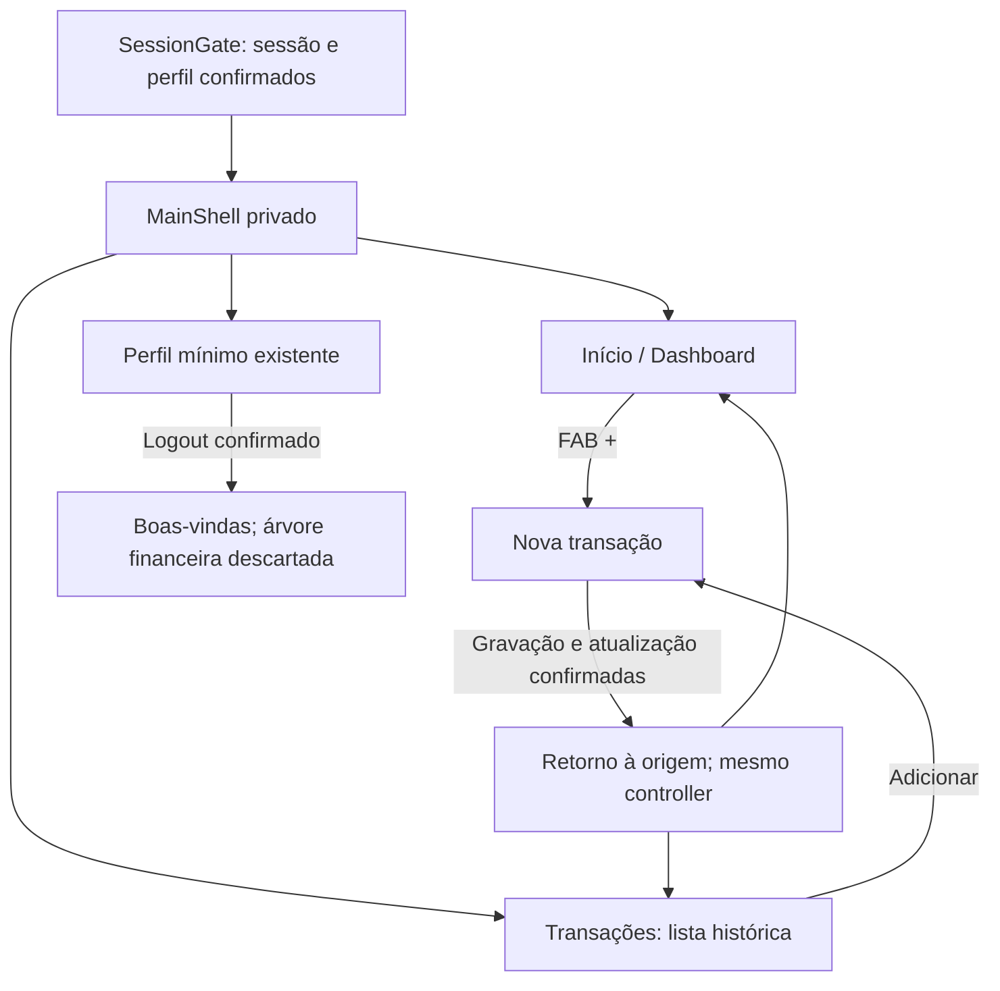

# M5 — Planejamento do Dashboard e Transações Essenciais

## Encerramento aprovado pelo usuário

**M5 encerrado com ressalvas documentadas.** O usuário testou manualmente o aplicativo integrado e aprovou seu funcionamento. A homologação extensa M5.6 foi expressamente dispensada; não foi executada nem será apresentada como teste aprovado. Situações de autorização/revisão abaixo são históricas.

Entregues Dashboard/Histórico, receitas/despesas, navegação privada com FinancialController compartilhado, barreiras UID/expectedUserId e precisão monetária Web corrigida. Última suíte comprovada: **475 testes Flutter aprovados**; analyzer com **41 informes de depreciação**, sem erros/warnings. Não repetidos nesta tarefa documental/de Git. Evidências, aceite e distinção entre testes e uso manual em [M5_HOMOLOGACAO.md](M5_HOMOLOGACAO.md).

Transferidos ao M9: integração adicional Auth/Firestore local, verificações Android/Web ainda não realizadas, teclado/acessibilidade nativos, persistência após reinício real onde não comprovada e revisão dos 41 informes. Preservar cumulativamente as ressalvas do M4 (reinício autenticado Android, Chrome automatizado interrompido por OOM, teclado/TalkBack e diagnósticos históricos), conforme M4_HOMOLOGACAO.md. O total atual de 41 inclui os informes anteriores; não somar os 20 do M4 novamente. Nenhuma dessas pendências exige execução nesta tarefa ou reabre o marco encerrado.

Autorizados commit local exclusivo do M5 e planejamento posterior do M6; nenhuma implementação do M6, operação Firebase remota, push ou deploy. O planejamento M6 será preparado depois do commit, separado desta entrega M5.

## Situação vigente — M5.5 autorizado e implementado para revisão

M5.4 aprovado tecnicamente pelo usuário com 454 testes. Implementação restrita ao M5.5: MainShell é o destino pronto do SessionGate, com três abas reais Início/Transações/Perfil e formulário como rota secundária. **M5.6 não autorizado.** Este registro substitui os estados de autorização históricos abaixo.

MainShell recebe o TransactionRepository já fornecido por AppDependencies, SessionController e perfil confirmado. Cria uma única instância financeira no initState, inicia load uma vez e a descarta no dispose. Chave por navigationVersion/UID e Navigator privado já existente destroem a árvore/pilha em logout ou troca de identidade. Nenhuma segunda inicialização Firebase, assinatura Auth ou factory redundante de repositório foi criada; AppDependencies permanece reutilizado sem alteração.

IndexedStack preserva estado e rolagem de Dashboard/Histórico/Perfil durante alternância. NavigationBar oficial usa tema centralizado (primary/mintSurface, Roboto, ícones 24 e altura 64), somente três destinos. Fixture de cinco abas dos registros anteriores continua isolada. Dashboard mantém seu relógio de mês corrente; não há seletor mensal ou leitura por troca de aba.

FABs do Dashboard/Histórico usam o mesmo controller e abrem TransactionFormScreen no Navigator privado, sem barra inferior nessa rota. Ver todas seleciona a aba real. Retorno preserva a origem e não faz nova consulta: M5.4 já aguarda recarga completa posterior ao commit. Em atualização pendente, formulário oferece somente retry de leitura; saída manual conserva aviso de dados desatualizados no shell. Respostas antigas não reabrem a área privada. O perfil real M4 e seus fluxos de login/cadastro/recuperação/conclusão continuam reutilizados.

Testes e evidências finais estão no registro M5.5 de PROGRESSO.md e em M5_5_VALIDACAO_VISUAL.md. Testes desta etapa usam fakes locais, não homologam persistência remota nem plugins no Android. Próximo passo depende de revisão/autorização explícita do M5.6, sem iniciar essa etapa automaticamente.

## Situação vigente após autorização M5.4

M5.1/M5.2 e visual revisado do M5.3 aprovados pelo usuário. **M5.4 entregue para revisão; M5.5 não autorizado.** Os estados abaixo registram o histórico do planejamento, sendo substituídos por esta decisão quando divergentes.

Dashboard passa a usar somente o mês corrente local, sem seletor visual. FinancialMonth/selectMonth continuam disponíveis no controller para reutilização futura; Orçamento/Relatórios manterão seleção própria de períodos. Timer local de virada e retomada do aplicativo atualizam a competência em memória, sem nova leitura ou logout. Histórico recebe apenas os ajustes aprovados de títulos, cabeçalhos e ícones; sem redesenho.

M5.4 concretizado com TransactionFormScreen, TransactionValidation e createTransaction no FinancialController. Formulário valida antes de enviar; grava pelo contrato existente com expectedUserId. Resultado diferencia confirmado, gravação confirmada com atualização pendente, falha definida, resultado incerto, sessão invalidada e envio em andamento. Após gravação, uma nova carga completa verifica a presença do ID confirmado antes de publicar sucesso atualizado. Refresh concorrente é compartilhado, escrita nunca repetida automaticamente. Perfil/sessão e respostas tardias continuam protegidos.

Em falha operacional de resultado desconhecido, não é possível garantir que o servidor cancelou a criação. O mesmo formulário fica bloqueado contra reenvio, permite somente leitura para conferir histórico e não transforma incerteza em sucesso. IDs idempotentes/reconciliação persistente não foram introduzidos nem contratos alterados. Falha de leitura após commit permite retry de leitura sem duplicar a movimentação.

454 testes normais aprovados e dois testes de captura separados com 18 PNGs; analyzer com 37 informes, sem erros/warnings. Evidências e limitações em PROGRESSO.md, M5_3_VALIDACAO_VISUAL.md e M5_4_VALIDACAO_VISUAL.md. Aplicação normal continua no fluxo aprovado do M4; nenhum formulário/aba financeira conectado antes do M5.5. Google Login e BolsoZen Bot permanecem ideias futuras fora do MVP.

## Histórico do planejamento e das entregas anteriores

As autorizações e decisões de interface dos registros seguintes retratam suas respectivas etapas. A situação vigente e as alterações aprovadas estão no início deste documento.

**Atualização histórica da revisão visual M5.3:** aceite visual anterior havia sido revogado pelo usuário. Foi expressamente autorizada a reprodução de sino/olho/meta neutra/categorias/recentes/FAB e busca/chips visuais indisponíveis, mais projeção simples de datas, sem implementar funcionalidades completas M6–M8 ou alterar navegação. A revisão foi posteriormente aprovada, conforme situação vigente acima. Auditoria/comparações em [M5_3_VALIDACAO_VISUAL.md](M5_3_VALIDACAO_VISUAL.md). Navegação de cinco destinos é somente fixture nas capturas, não produção.

**Status: M5.1/M5.2 aprovados; M5.3 implementado para revisão. M5.4 e posteriores não autorizados.** Base: M4 encerrado/aprovado com ressalvas no commit `606af8b5cee6eeba349d9aab22af1f5d89be9551`, branch main. Android principal; Web complementar; pt-BR. Aprovação expressa: Início/Transações/Perfil temporários, Orçamento no M7, Relatórios no M8, omissão de recursos futuros, seletor mensal, barreira expectedUserId, carga completa paginada e recarga compartilhada após gravação. Precisão monetária e controller aprovados. Nesta etapa, somente telas/componentes isolados, sem criação de movimentações ou ligação à aplicação normal.

## M5.3 — Dashboard e histórico isolados

DashboardScreen e TransactionsScreen observam o FinancialController real por ListenableBuilder. Não iniciam consultas no build nem possuem acesso Firestore ou cálculos financeiros próprios. Perfil confirmado é injetado; Dashboard verifica correspondência do UID antes de mostrar nome/valores. Estados invalidated removem conteúdo privado. A composição/navegação normal, onboarding, autenticação e Perfil mínimo permanecem intactos.

Componentes usados: BalanceCard, MonthlyTotalsCards, FinancialMonthSelector, TransactionTile, CategoryIcon e FinancialLoadState. Layouts usam AppTheme/Roboto, AppColors/AppSpacing/AppRadii, Material 3, SafeArea e rolagem; não foram alterados os tokens globais. Valores são formatados pelo Money aprovado; competência muda apenas via controller. Lista usa ListView.builder sobre o histórico confirmado e mantém a ordem do domínio. Ícones nativos equivalentes ao protótipo; tipos distinguem-se por rótulo, sinal e cor, não apenas cor.

FinancialLoadState apresenta idle/carregar, loading, refreshing, empty, error/retry e sessão invalidada; ready mostra o snapshot. Não mostra zeros antes da confirmação. Atualização/erro com snapshot anterior apresenta aviso explícito de possível desatualização **fora da rolagem**, para não desaparecer enquanto dados antigos continuam visíveis. A atualização manual é funcional e deduplicada pelo controller. Lista vazia é real, sem CTA de criação inexistente.

Adaptações autorizadas nesta subetapa: omitir busca/chips/agrupamento/edição/exclusão/recentes/olho (M6), orçamento (M7), relatórios (M8), FAB/formulário (M5.4) e barra inferior/rotas (M5.5). O Dashboard indica em texto a área Transações; esse texto não tem aparência de botão nem navega prematuramente. A ligação real à lista virá com o shell autorizado. Não há números de exemplo em lib/ ou inicialização fictícia no app.

Evidências: **407 testes Flutter aprovados**, 374 anteriores + 33 widgets novos; captura isolada opt-in adicional aprovada com dez PNGs. Analyzer: zero erros/warnings, **30 informes de depreciação** (20 anteriores e dez imports Material oficiais novos), sem supressão ou instalação de UI alternativa. Comparação TEL-04/TEL-06, diferenças intencionais, fontes, screenshots e limites em [M5_3_VALIDACAO_VISUAL.md](M5_3_VALIDACAO_VISUAL.md). Evidência é do renderer Flutter de testes, não Android/Chrome; não declarar pixel-perfect ou homologação final de plataforma. Aguardar revisão visual do usuário. M5.4 só poderá começar com nova autorização; integração ao app segue M5.5.

## M5.2 — FinancialController e carga financeira

Implementação restrita a lib/presentation/controllers/financial_controller.dart e testes determinísticos em test/presentation/financial_controller_test.dart, com atualização deste plano e PROGRESSO.md. Nenhuma ligação ao app normal, AppDependencies, SessionGate, navegação ou telas. Não há create/update/delete no controller.

### API e identidade

FinancialController estende ChangeNotifier, preparado para consumo por ListenableBuilder nos próximos marcos, sem widgets financeiros nesta etapa. Recebe TransactionRepository, expectedUserId imutável, SessionController e initialMonth opcional (padrão mês local corrente). O SessionController já existente é observado apenas para confirmar sessão/perfil/UID e navigationVersion; autenticação não é modificada nem são criadas novas assinaturas Firebase.

A vinculação da sessão é explícita no construtor para tornar a invalidação imediata testável antes de existir MainShell. Isso concretiza a proteção planejada: o futuro shell será dono/disporá do controller, mas não precisará ser a única barreira contra troca de identidade. Sessão não pronta/UID divergente invalida a instância sem consulta. Logout confirmado, perda de estado pronto, troca de UID ou versão de identidade encerram definitivamente o controller, inclusive A -> B -> A. Outra sessão requer nova instância.

Estados FinancialPhase: idle, loading, refreshing, ready, empty, error e sessionInvalidated. Getters: month, phase, transactions, summary, failure, isLoading, hasConfirmedSnapshot e isStale. Métodos: load (carga inicial idempotente), refresh, retry e selectMonth. A lista confirmada e FinancialSummary são imutáveis. Summary permanece null antes de confirmação completa; zero/vazio só após carga vazia confirmada. Não usar failure/phase como substituto de aprovação da sessão.

### Paginação e publicação

- fetchPage(limit: 100, after: último item bruto, expectedUserId: UID fixo) sequencial até página com menos de 100, inclusive consulta vazia depois de múltiplo exato.
- Buffer local por ID; duplicata de conteúdo integralmente igual não soma duas vezes. Divergência de qualquer campo do mesmo ID gera invalidData. Dados de outro UID invalidam a sessão financeira e removem o snapshot, sem depender do filtro do calculator.
- Valida limite de página, cursor repetido/cíclico e avanço pela tupla occurredAt DESC, createdAt DESC, ID ASC. Não usa comprimento deduplicado para encerrar nem o último item do mapa como cursor.
- Valida dinheiro de cada registro com a política M5.1, inclusive quando um fake/futura implementação não usar o mapper. Não replica saldo/totais: publicação atômica de FinancialCalculator.summarize e seu history apenas ao concluir todas as páginas.
- Mês pode mudar durante leitura; o cálculo final usa a seleção mais recente. Com snapshot confirmado, mudar mês recalcula em memória sem consulta, conservando a distinção stale durante refresh/erro.

Uma operação/Future é compartilhada por load/refresh/retry concorrentes e reentrantes. Após carga concluída, load não consulta de novo; refresh explícito percorre novamente o histórico. Geração, estado de sessão e versão da identidade são conferidos antes de cada operação e após awaits. Dispose remove listener, limpa dados e impede notificações tardias; não representa cancelamento da operação de rede já iniciada.

Na atualização, somente o snapshot completo anterior do mesmo UID pode permanecer, com isStale=true. Falha intermediária não publica o buffer; erro de rede mantém esse snapshot explicitamente desatualizado. Permission-denied remove o snapshot; falhas de sessão/UID invalidam a instância. Falhas de dados/cálculo viram invalidData, falhas inesperadas viram unknown com mensagem segura, sem expor exceção bruta. Se mudar competência causar falha no domínio, ocultar resumo/lista em vez de associar totais antigos ao novo mês.

### Aceite técnico e limites M5.2

374 testes Flutter aprovados, preservando 337 anteriores e acrescentando 37. Conjuntos 0/100/101/200/201, cursores brutos, deduplicação/conflito/ciclo/retrocesso, erro intermediário, retry, saldos e datas, alteração de mês, snapshot stale, reentrância, logout/troca A-B-A, dispose/respostas tardias, novo controller B independente, UID do SDK divergente antes do evento e valores incompatíveis cobertos com fakes, sem Firebase remoto.

Analyzer mantém 20 informes preexistentes, zero erros/warnings; format e diff-check aprovados. Logs locais ignorados em build/m5-2-*. Nenhum build Android ou nova bateria Web. Testes do controller não equivalem a integração SDK real ou homologação visual; essas evidências pertencem aos próximos marcos autorizados.

Persistem os limites já planejados: custo/memória proporcional ao histórico e páginas não atômicas diante de alterações externas. A proteção detecta cursores/conteúdos incompatíveis, mas não promete snapshot transacional da coleção. A calculadora existente também pode rejeitar competências extremas cuja janela anterior ultrapasse seu calendário suportado; erro fica explícito, sem mudar regras de domínio neste marco. A futura UI deve respeitar phase/isStale e nunca rotular o snapshot anterior como atualizado. M5.3 depende da revisão/autorização do usuário; envio/recarga após criação somente no M5.4 e composição normal somente no M5.5.

## M5.1 — Correção monetária autorizada e entregue para revisão

O usuário aprovou a barreira expectedUserId e autorizou especificamente corrigir a precisão com limite técnico comum de **9007199254740991 centavos**. Este registro substitui o estado de correção pendente dos registros históricos seguintes. M5.2 continua não autorizado.

### Política adotada

- Entrada textual: Money.parseCents preserva a gramática pt-BR e lê os dígitos originais com BigInt. Só converte para int após verificar valor positivo e faixa segura. Acima do limite, lança FormatException com orientação em português, inclusive para 2^53 e números pares isoladamente representáveis. Não se trata de um teto comercial.
- Persistência/leitura: Money.requireSafeCents centraliza a faixa assinada. Mapeadores de transação e orçamento validam valores int recebidos do SDK e valores de saída. Criação de transação e save de orçamento também validam antes de acessar o SDK; update de transação reutiliza o mapper, sem mudar seu contrato. Nenhuma escrita financeira desses caminhos ultrapassa a faixa.
- Um inteiro Firestore grande pode já ter sido arredondado pelo SDK Web; não tentar recuperá-lo com BigInt. Como valores fora da faixa segura continuam fora dela após o arredondamento IEEE-754 nessa fronteira, são recusados. Campos double/fracionários ou incompatíveis continuam inválidos. Não substituir falha por zero, omitir silenciosamente registro ou apresentar aproximação. guardData traduz FormatException em invalidData conforme infraestrutura atual.
- Domínio nativo: modelos int permanecem inalterados e a calculadora mantém BigInt para acumular e conferir a conversão exata ao inteiro nativo. Cálculos/formatação nativos maiores continuam possíveis e testados; parse e Firestore passam a exigir a faixa interoperável. Não persistir agregados.
- Web/JavaScript: _sum valida as entradas e verifica a soma BigInt antes de convertê-la para int; agregado acima da faixa lança StateError explícito. formatCents também rejeita inteiros fora da faixa, inclusive um valor já arredondado antes da chamada. Não há arredondamento silencioso para conseguir exibir saldo. Nenhuma publicação de resumo parcial.
- As fórmulas de saldo, totais mensais, categorias, percentuais e indicadores não foram alteradas. Porcentagens continuam double dimensionais, não dinheiro. Não foi criado outro modelo monetário, dependência ou alteração de esquema/regra Firestore.

### Evidências e compatibilidade

337 testes Flutter aprovados: os 322 casos anteriores foram mantidos e 15 acrescentados. Asserções antigas que aceitavam parsing/persistência acima da faixa foram ajustadas para a nova política aprovada, sem remover testes. Formatação nativa de 9007199254740993, agregação nativa exata acima da faixa e proteção contra overflow int64 permanecem cobertas. Novos testes recusam ,92/,93/,94/,95 fora do limite, verificam mensagem, limites positivo/negativo, mapeadores de ida/volta e rejeição antes do SDK.

Probe puro executado na VM e com dart2js no Chrome real: quatro entradas aceitas/exatas e quatro rejeitadas; conversão numérica prévia dos quatro valores grandes também rejeitada. Agregado 9007199254740993 é exato na VM e rejeitado antes da conversão na Web. Nenhuma perda detectada nos valores aceitos. Não repetir a suíte Flutter Chrome/DDC que travou na etapa anterior; a evidência desta execução é do código Dart real compilado por dart2js, não da aplicação inteira em DDC. Não houve OOM nesta execução.

Resultados completos e arquivos em PROGRESSO.md. Permanecem fora desta etapa: integração Firestore real/Web para esses extremos, testes de UI futura e execução Android no MSI. Nenhum dado remoto lido/alterado; regras atuais não receberam teto novo, portanto outro cliente ainda pode gravar dados incompatíveis, que este aplicativo recusará explicitamente na leitura. Não é possível detectar retrospectivamente um valor adulterado/arredondado por outro sistema e já armazenado dentro da faixa sem informação da origem; não há promessa de reconstrução de centavos perdidos.

## Histórico: diagnóstico inicial M5.1 — 17/11/2026

Este registro atualiza as propostas e autorizações históricas das seções seguintes. Barreira de sessão implementada; investigação monetária concluída com defeito Web reproduzido. Correção monetária apenas proposta, aguardando aprovação específica.

### Segurança implementada

TransactionRepository e FirestoreTransactionRepository receberam expectedUserId opcional somente em fetchPage/create. FirebaseSession.uid continua determinando o proprietário; o argumento apenas exige correspondência antes de montar consultas/gerar documentos. Verificações existentes na transação e após awaits foram preservadas. update/delete, domínio monetário, navegação e configuração Firebase não mudaram. Chamadas antigas continuam compatíveis; o futuro FinancialController deverá fornecer o argumento em todas as leituras/criações.

14 testes controlados cobrem identidade correta/divergente, ausência de sessão, compatibilidade, troca/logout durante leitura/criação, antes do callback transacional e após a escrita antes da confirmação. Usam transporte SDK simulado em memória, sem backend. Não comprovam regras remotas nem cancelamento de uma escrita já enviada. Tags do protocolo Pigeon no fixture correspondem à versão instalada e podem exigir manutenção em upgrades.

### Precisão Web: defeito reproduzível, sem correção automática

Probe independente em test/diagnostics/money_precision_probe.dart, usando o Money real e strings/BigInt como referência, executado no Dart nativo e compilado por dart2js para JavaScript no Node e Chrome real. Oito valores: 1, 123456, 9007199254740990, 9007199254740991, 9007199254740992, 9007199254740993, 9007199254740994 e 9007199254740995 centavos. Parsing, int.parse, formatação positiva/negativa e round-trip verificados.

| Entrada em reais | Dart nativo | JavaScript/Chrome |
|---|---|---|
| 90071992547409,91 | Exata | Exata |
| 90071992547409,92 | Exata | Exata: 2^53 isoladamente representável |
| 90071992547409,93 | 9007199254740993 centavos | Arredonda para 9007199254740992; apresenta R$ 90.071.992.547.409,92 |
| 90071992547409,94 | Exata | Exata: alguns inteiros acima da fronteira são representáveis |
| 90071992547409,95 | 9007199254740995 centavos | Arredonda para 9007199254740996; apresenta R$ 90.071.992.547.409,96 |

Os oito casos são exatos na VM; dois perdem precisão em JavaScript. O diagnóstico terminar com exit 0 significa reprodução bem-sucedida, não aprovação da precisão Web. Formatar um int já arredondado não recupera o texto original. O probe Chrome usa dart2js, não a aplicação Flutter completa; os testes Flutter Web dos valores representáveis são registrados separadamente no progresso.

**Correção mínima proposta, não implementada:** preservar gramática/API de Money.parseCents, analisar os dígitos com BigInt, converter para int e comparar BigInt.from(resultado) ao original; rejeitar com FormatException qualquer conversão inexata/fora da faixa nativa. Preservar formatCents, centavos int, testes nativos exatos e dependências atuais. Isso altera quais entradas Web são aceitas e requer aprovação específica. Não introduzir teto comercial, arredondamento ou segundo modelo monetário.

Limitação adicional: rejeitar entradas inexatas não protege dados nativos grandes já convertidos pelo SDK JavaScript antes de chegar ao mapper. Uma política uniforme de faixa segura entre plataformas (por exemplo 9007199254740991 centavos) exigiria decisão separada sobre contratos/modelos/persistência; não está implementada nem autorizada implicitamente. A calculadora já verifica a conversão de suas somas BigInt, mas não recupera valores de entrada previamente arredondados. Resolver essa decisão antes de conectar entrada financeira Web.

Reprodução local, sem Firebase:

```text
dart test/diagnostics/money_precision_probe.dart
dart compile js -O1 -o build/m5-1-money-probe.js test/diagnostics/money_precision_probe.dart
node build/m5-1-money-probe.js
node test/diagnostics/run_money_precision_browser.cjs
flutter test --platform chrome test/domain/money_precision_test.dart --concurrency=1
```

O runner Node usa somente módulos nativos, servidor loopback e Chrome headless próprio; não inicializa Firebase. Artefatos e perfil temporário ficam em build/ ignorado. Não inicia com o app nem integra a suíte remota. Validação e contagens finais em PROGRESSO.md.

## 1. Fontes, diagnóstico e limites

Revisados AGENTS.md, PLANO.md, PROGRESSO.md, documentos 01–05, PLANO_M4.md, M4_HOMOLOGACAO.md, protótipo oficial e código financeiro/dados/sessão/composição. Documentos definem comportamento; Design System define tokens; prancha define composição. M4 e seus componentes aprovados serão preservados. As limitações M4 transferidas ao M9 não são reabertas como bloqueio deste planejamento.

Incluído: Dashboard inicial, saldo global, receitas/despesas da competência selecionada, lista real de transações, criação de receita/despesa, valor/categoria/data/descrição, Conta principal informativa, atualização após gravação, estados reais, paginação completa e isolamento por sessão.

Excluído: editar/excluir, busca, filtros de tipo/categoria, agrupamentos avançados, recorte de recentes, ocultação do saldo (M6), orçamento/limites/alertas (M7), gráficos/relatórios/evolução/comparações (M8). Não antecipar os demais marcos a partir dos elementos desenhados. O seletor **de competência dos totais** está autorizado no M5; não é filtro avançado da listagem nem o seletor/editor de orçamento do M7.

Google Login e BolsoZen Bot são possíveis melhorias futuras, **fora do MVP**. Nenhuma alteração dos marcos M5–M9 por essas ideias.

### Código existente a reutilizar

| Componente real | Uso previsto e observações |
|---|---|
| FinancialCalculator.summarize | Única origem dos cálculos; recebe userId, FinancialMonth e histórico completo. Ordena ocorrência/criação DESC e ID ASC, filtra UID e retorna FinancialSummary |
| FinancialTransaction | Modelo imutável, valor int positivo, descrição trim/1–120 runes e categoria compatível; não criar entidade concorrente |
| FinancialSummary / MonthlyTotals | Saldo/totais/history derivados. Dados de orçamento/relatório já presentes no resultado não autorizam mostrar esses módulos no M5 |
| Money, em lib/domain/services/money.dart | parseCents/formatCents sem double intermediário; não existe models/money.dart. Reutilizar a classe existente, sem outro modelo monetário |
| Category / TransactionType | Enum com IDs persistidos e Category.forType: despesas food/transport/shopping/leisure/health/education/housing/other_expense; receitas salary/other_income |
| FinancialMonth | Calendário local, key YYYY-MM, contains, shift; usado para competência e virada de ano |
| TransactionRepository | fetchPage(after: FinancialTransaction?, limit: 100) e create(...) -> Future<String>. Create retorna ID, não o documento com timestamps confirmados. Não chamar update/delete neste marco |
| FirestoreTransactionRepository | Caminho do UID atual; Source.server; ordem occurredAt DESC, createdAt DESC, documentId ASC; cursor com esses valores; limite 1–100. Create transacional, ID e auditoria gerados nos dados |
| FirebaseSession / DataFailure | Verificações de identidade antes/durante/depois de operações e falhas tipadas existentes; nenhuma exceção Firebase bruta na UI |
| SessionController / SessionGate | Sessão/perfil confirmados antes da área privada; versões e Navigator interno descartam árvore ao sair/trocar identidade |
| AppDependencies | Já fornece transactions, auth, users e budgets; reutilizar mesma instância Firebase. Não inicializar Firebase novamente nem consultar budgets no M5 |

Índice versionado já corresponde à consulta paginada. Seu estado remoto não foi consultado neste planejamento; aprovação histórica do M3 não substitui uma execução futura. Não criar/publicar índice ou mudar regras automaticamente em caso de erro.

## 2. Arquitetura e ciclo de vida

Manter três camadas. Domínio financeiro e repositórios continuam responsáveis por regras e Firestore; widgets apenas coletam entradas e apresentam modelos. Propor **FinancialController com ChangeNotifier**, consumido por ListenableBuilder, sem Provider/Riverpod/BLoC ou dependências novas. Estado local de campos/foco/tipo do formulário usa Form, TextEditingController e setState.

FinancialController recebe TransactionRepository e identidade esperada imutável da sessão pronta. Não recebe UID digitado e não é singleton/global. Mantém competência, lista imutável confirmada, FinancialSummary?, estado de carregamento/atualização, falha de leitura e estado separado de envio. Métodos previstos: carregar/recarregar, selecionar competência e criar transação. Nenhum método de edição/exclusão/orçamento.

Um MainShell stateful será criado **dentro do readyBuilder do SessionGate**, somente para sessão/perfil válidos; será dono de um controller financeiro compartilhado entre Dashboard, Transações e formulário. AppDependencies fornecerá sua factory sem iniciar consultas na composição. SessionController continuará responsável apenas por autenticação/perfil; não receberá cálculos ou cópias de transações.

MainShell escuta a sessão para invalidar imediatamente dados/operadores quando perder isReady ou mudar navigationVersion/UID; descarta listeners/controllers no dispose. O SessionGate permanece dono da proteção e destruição do Navigator privado. Todo push de formulário usa seu Navigator interno, nunca rootNavigator. Perfil e logout aprovados continuam reutilizados, sem novo fluxo de autenticação.

### Barreira necessária antes de iniciar acesso

Identificada uma corrida a planejar: fetchPage/create hoje capturam FirebaseSession.uid no início da operação, mas não recebem a identidade esperada do controller. O SDK pode já ter mudado A -> B antes de o evento chegar à apresentação; então a primeira página ou o formulário antigo de A poderia iniciar operação na sessão B. Verificações depois do await e filtro do calculator não impedem essa gravação inicial.

Propor extensão compatível **expectedUserId opcional em fetchPage/create**, como já aprovado/implementado em UserRepository no M4.3. FinancialController sempre o fornece, obtido da sessão pronta; FirestoreTransactionRepository confere session.verify(expectedUserId) antes de montar caminho/gerar documento e mantém as verificações atuais. Caminho e userId continuam vindos exclusivamente de FirebaseSession.uid, nunca do argumento. Não alterar regras, identidade persistida, update/delete ou FirebaseSession para aceitar UID arbitrário. Adaptar fakes/testes afetados preservando chamadas antigas. Essa pequena mudança de contrato precisa integrar o aceite do plano antes de implementação.

## 3. Carregamento, cálculo e sincronização

### Leitura completa com paginação

1. Iniciar uma única leitura quando a área privada pronta for montada. Não ler em build, a cada troca de aba ou mudança de mês.
2. Usar fetchPage(limit: 100, after: cursor) sequencialmente, com o UID esperado e geração da requisição capturados. Sem consultas paralelas de páginas dependentes.
3. Acumular em buffer privado por ID, sem publicar saldo/totais ou vazio antes do término. Cursor será o **último item bruto da página**, com ocorrência/criação/ID reais; nunca usar contador de itens deduplicados como cursor.
4. Página com menos de 100 itens conclui o percurso; se houver exatamente 100, buscar a próxima, inclusive vazia. Cobrir 0/100/101/200/201 registros. Não impor truncamento silencioso de histórico.
5. Deduplicar IDs iguais com conteúdo idêntico. Cursor sem avanço, ciclo de páginas, registros com mesmo ID e conteúdo conflitante ou UID divergente invalidam a carga; não entrar em loop nem somar duas vezes. Dados inválidos não são ignorados para fabricar um total.
6. Ao concluir todas as páginas e confirmar geração/identidade, executar FinancialCalculator.summarize(userId, month, transactions) e publicar atomicamente lista/resumo. Usar summary.history para a ordem da UI. Sem paginação faltante, soma de totais anteriores ou agregados persistidos.

Enquanto carrega: indicador e texto de atualização, sem números parciais apresentados como definitivos. Erro na página 2/3 não publica resumo da página 1. Primeiro acesso com falha não mostra R$ 0,00/vazio como se o servidor estivesse vazio. Vazio real somente após carga completa com zero registros.

Em recarga, pode conservar apenas o snapshot completo anterior **do mesmo UID**, identificado como dados da última carga/atualização pendente; nunca misturá-lo ao buffer novo ou descrevê-lo como atualizado. Se a UI não comportar essa distinção, ocultar os totais até concluir. Falha não deve apagar silenciosamente dados confirmados, mas exige aviso/retry. Em troca de sessão, apagar tudo imediatamente, inclusive snapshot anterior, competência/contexto de formulário e erros antigos.

FinancialController usará geração de leitura e versão de identidade, verificadas a cada await e antes de notificar. Reentrada em refresh compartilha a operação ou solicita somente uma nova carga posterior quando necessário. Dispose/logout/A -> B -> A tornam respostas antigas inaplicáveis. Future cancelado pela UI não significa operação cancelada no SDK; não depender apenas de mounted do widget.

### Regras financeiras e competência

- Dinheiro: amountCents int; Money.parseCents/formatCents. Não usar double para armazenar, converter input ou calcular saldo/totais.
- Saldo global: receitas menos despesas de **todo histórico**, inclusive movimentos futuros registrados; negativo e zero permitidos no saldo.
- Receitas/despesas mensais: summary.totals para FinancialMonth selecionado, baseado em occurredAt no calendário local, não createdAt. Trocar competência recalcula em memória, sem consulta Firestore e sem alterar saldo global.
- Inicializar competência com mês corrente do dispositivo. Propor navegação anterior/próximo mês, rótulo mês/ano, usando FinancialMonth.shift e limites de ano suportados. Lista principal continua histórica, não filtrada pelo seletor dos cards.
- Manter calculadora e modelos atuais; não replicar fórmulas nos widgets. Recalcular a partir da coleção confirmada, não adicionar/subtrair sobre resumo anterior. Não usar campos de orçamento/relatório do resultado para ampliar o escopo.

### Depois de gravar

Bloqueio de submissão no controller e botão; validação antes do repositório. Sem inclusão otimista ou timestamps inventados. Create retorna ID após a confirmação transacional; **não retorna FinancialTransaction completo**. Estratégia inicial recomendada: uma única recarga paginada completa após a criação confirmada, compartilhada por Dashboard/lista. Não inventar createdAt/updatedAt nem contornar o repositório com acesso Firestore no widget.

Separar dois resultados: gravação confirmada e recarga concluída. Se create confirmar e a recarga falhar, informar “Movimentação salva; não foi possível atualizar os dados”, bloquear novo envio daquele formulário e oferecer **atualizar dados**, não chamar create de novo. Se usuário sair do formulário após confirmação, a próxima tela mantém aviso de atualização pendente. Se create falhar sem confirmação, preservar entradas e apresentar falha; sem retry automático nem mensagem de sucesso. Timeout/troca de sessão não garantem que uma gravação em andamento foi desfeita; reconciliar com leitura antes de orientar novo envio quando resultado for incerto. Não introduzir timeout ou política nova de idempotência sem evidência/decisão.

Atualização concluída recalcula a competência atualmente selecionada. Inserção retroativa/futura pode alterar saldo global sem alterar os cards desse mês: comportamento correto, sem forçar data/mês da transação ao mês selecionado.

### Leituras e limites de consistência

Reusar o mesmo conjunto em Dashboard/lista; nenhuma consulta paralela por card, mês, categoria ou aba. Uma carga inicial, refresh manual, recarga após gravação confirmada e ao retomar a área financeira do background, com solicitações simultâneas consolidadas. Retorno de Perfil/formulário sem mudanças não dispara leitura adicional só por navegação. Sem polling, listeners adicionais ou novo serviço de agregação no M5.

Custo de uma carga é proporcional ao histórico; após criação, novo percurso tem custo semelhante. Aceitável inicialmente para o volume acadêmico, medido em massa de teste; sem prometer escala ilimitada. Otimização futura por leitura do documento criado exigiria extensão do contrato e reconciliação de mudanças externas; não adicionar essa abstração agora.

Páginas são leituras de servidor independentes, **não snapshot transacional único de toda a coleção**. Atualizações em outro cliente durante o percurso podem exigir refresh e não são eliminadas apenas por deduplicação. Serializar gravações deste controller com recarga; não anunciar sincronização em tempo real/multidispositivo. O resultado completo é o do último percurso concluído, não garantia atômica do banco em cada instante. Limitação e testes de concorrência devem constar da entrega; não persistir contadores para disfarçá-la.

## 4. Fluxo e fidelidade visual



Dashboard passa a ser o destino após login, conforme decisão M4/M5; nenhum push privado nos métodos de login/cadastro. MainShell mantém três destinos reais Início/Transações/Perfil, usando NavigationBar oficial e IndexedStack para preservar estado sem repetir consultas. Nova transação é rota secundária com seta Voltar, sem barra inferior duplicada. Ao confirmar logout/trocar UID, gate remove inclusive formulário e rotas do usuário anterior. Falhas de perfil continuam nos estados aprovados M4.

### Mapa do protótipo e adaptação incremental proposta

| Referência | Preservar no M5 | Adaptação temporária a aprovar |
|---|---|---|
| TEL-04 cabeçalho | Saudação/nome real, avatar simples com inicial, hierarquia/alinhamento da prancha | Omitir sino sem notificações, não criar ação decorativa |
| TEL-04 Saldo total | Card dominante verde primary, texto branco, rótulo/valor em destaque; saldo negativo com sinal explícito | Sem olho/ocultação, previsto M6; nunca inserir R$ 5.320,00 ilustrativos |
| TEL-04 indicadores | Cards brancos/sombra sutil, ícones seta ↑ verde/↓ vermelho, rótulos Receitas/Despesas e valores reais | Dois cards adaptados à largura; omitir Meta do mês/percentual do orçamento M7, sem 0% ou botão falso |
| Competência dos totais | Linguagem de chevrons/calendário e mês/ano já presente na família visual, tokens comuns | Pequeno seletor explícito junto aos cards mensais; complementar à prancha TEL-04. Não filtra toda a listagem |
| TEL-04 conteúdo inferior | Mesmo fundo/espaçamento/FAB verde + | Omitir barras de gastos/atalhos M7–M8 e recorte Transações recentes M6. Oferecer acesso funcional à lista completa, sem cópia de números/desenhos falsos |
| TEL-06 lista | Título Transações, linhas com ícone pastel, descrição/categoria/data e valor à direita com +/−, rolagem e botão Adicionar | Sem busca, chips Todas/Receitas/Despesas, agrupamentos, menus, chevrons ou toque de editar/excluir M6; lista simples ordenada. Item não simula ação inexistente |
| TEL-05 formulário | Retorno/título, Receita/Despesa, Valor, Categoria, Data, Descrição, Conta principal e Salvar transação | Conta não editável e sem dropdown falso; sem qualquer campo de edição de transação existente |
| Barra inferior | Ícones/rótulos Material, primary/mintSurface no ativo, dimensões e estilo da família | Somente Início, Transações e Perfil neste marco; Orçamento/Relatórios entram nos marcos próprios, sem placeholders ou abas desabilitadas |

Tokens existentes AppColors/AppSpacing/AppRadii/AppTheme: primary #0E7D68, secondary #10B981, mint #A7F3D0, mintSurface #E9FDF6, background/surface brancos, surfaceMuted #F3F4F6, textPrimary #111827, textSecondary #6B7280, border #E5E7EB, error #EF4444. Roboto; títulos 20/700, pequenos 16/600, corpo 14, legenda 12, saldo 24–28 conforme estilo existente. Espaçamentos 4/8/12/16/24/32, padding 16, botões/campos raio 12, cartões 16, elevação sutil e alvos de toque 48 dp. Não instalar fontes/ícones/gráficos nem redesenhar autenticação, logo ou onboarding.

Ícones oficiais equivalentes aos contornos da prancha; catálogo visual na apresentação, sem IconData/cores no domínio: food talheres, transport carro, shopping sacola, leisure controle, health coração/cruz, education livro, housing casa, others mais opções; receita seta/carteira. Cores decorativas somente dos tokens existentes, sem inventar hex por categoria não especificada. Sempre rótulo e sinal além de cor.

SafeArea, layout flexível e rolagem; cards empilham com largura/texto ampliado sem cortar valores. Sem barra iOS ou imagens alternativas. Loading/erro/vazio ocupam o contexto real; após carga vazia mostrar R$ 0,00 legítimo e chamada para primeiro lançamento. Comparar screenshots reais, não aprovar visual só com testes. As adaptações acima são propostas de escopo/fidelidade para revisão, não alterações já realizadas nos documentos-base.

## 5. Formulário de lançamento

- Tipo Receita/Despesa com seletor nativo coerente com TEL-05; início proposto em **Despesa**, decisão de rotina documentada para revisão. Trocar tipo limpa categoria incompatível e não altera valor/data/descrição.
- Valor textual em reais com prefixo R$, teclado decimal, exemplos de orientação como 120,50; aceitar o que Money.parseCents já suporta (120, 120,50, 1.234,56 e colagem R$). Evitar máscara automática invasiva/novo parser. Rejeitar vazio, zero, negativo, formato inválido e precisão não suportada. Formatar valor confirmado com Money.formatCents, sem converter para double.
- Category.forType alimenta DropdownButtonFormField nativo; nenhuma categoria previamente inventada ou persistida como coleção. Exigir escolha válida para o tipo no envio.
- Data inicial hoje local, seletor Material localizado pt-BR; permitir datas futuras conforme requisitos, sem restringir ao mês selecionado nem usar createdAt como ocorrência. Usar data de calendário local; datas já persistidas conservam suas conversões atuais. Respeitar faixa 1–9999 dos modelos, sem bloqueio arbitrário do futuro.
- Descrição obrigatória, trim e 1–120 runes conforme FinancialTransaction; erro claro, contador/limite coerentes com Unicode. Não manter regra duplicada divergente de modelo. Validação pura de entrada pode ser extraída pequena e reutilizável, sem recriar modelos/IDs/auditoria na UI.
- Conta principal como campo/linha informativa, sem seletor, entidade de contas ou novo campo Firestore.
- Form, foco no primeiro inválido, avanço por teclado, SubmitButton existente, desabilitar campos/ação durante envio, validação defensiva também no controller/repositório.
- Erro seguro pt-BR/feedback sem dados técnicos, valores preservados se não houve confirmação. Depois de confirmação, permitir somente atualização/retorno; não oferecer “salvar novamente” como solução a falha de leitura.

## 6. Arquivos previstos, criados apenas quando usados

| Arquivos | Responsabilidade |
|---|---|
| lib/presentation/controllers/financial_controller.dart | Ciclo de carga completa, criação, competência, estado/concorrência e chamada da calculadora |
| lib/app/main_shell.dart | Ownership privado do controller, três destinos reais e descarte por sessão |
| lib/presentation/screens/dashboard/dashboard_screen.dart | Saudação, saldo, competência/cards mensais, estado e acesso à lista/formulário |
| lib/presentation/screens/transactions/transactions_screen.dart | Lista completa confirmada em ListView.builder, renderização sob demanda, estado e adicionar |
| lib/presentation/screens/transactions/transaction_form_screen.dart | Somente criação, campos/validação/foco e feedback |
| lib/presentation/widgets/balance_card.dart, monthly_totals_cards.dart, financial_month_selector.dart | Componentes financeiros com tokens do tema, sem cálculos próprios |
| lib/presentation/widgets/transaction_tile.dart, category_icon.dart | Apresentação de modelo/categoria e sinais/semântica |
| lib/presentation/widgets/financial_load_state.dart | Estados de carga/vazio/erro compartilhados, quando houver uso em ambas as telas |
| lib/domain/services/transaction_validation.dart, se necessário | Pequenas validações puras de entrada, reutilizando Money/Category e contrato do modelo; sem SDK/widgets |
| lib/app/app_dependencies.dart, lib/app/auth_experience.dart | Factory do controller e troca de readyBuilder para MainShell; preservar demais fluxos M4 |
| lib/domain/repositories/transaction_repository.dart, lib/data/repositories/firestore_transaction_repository.dart | Apenas barreira expectedUserId proposta para leitura/criação; sem implementar novos módulos |
| lib/domain/services/money.dart e testes existentes, somente se reproduzido risco de precisão | Ajuste mínimo sujeito à decisão técnica descrita abaixo; nunca segundo tipo monetário |
| test/presentation/financial_controller_test.dart, financial_screens_test.dart, transaction_form_test.dart, financial_test_fakes.dart | Fakes controlados e testes funcionais/concorrência/UI |
| test/data/repository_session_test.dart e testes afetados de domínio | Contrato/UID e regressões monetárias/ordenação |
| integration_test/m5_financial_emulator_test.dart e supervisor local em firebase/tests/, quando necessário | Integração isolada com repositórios reais, sem main/opções de produção; modo padrão bloqueado |
| docs/PROGRESSO.md e evidências da etapa | Resultados reais, limitações, screenshots e revisão |

Reutilizar SubmitButton, feedback/tema e padrões Form/SafeArea do M4. AuthFormLayout pode orientar padding/rolagem do formulário, sem impor cabeçalho de autenticação às telas financeiras. Não criar os arquivos antecipadamente nem extrair abstrações sem dois usos concretos. Nenhuma mudança de pacote, Gradle, regras, índices, FirebaseOptions ou autenticação prevista.

## 7. Testes planejados

| Camada | Casos e evidência exigida |
|---|---|
| Domínio/regressão M2 | Saldo positivo/zero/negativo; T1 saldo 60000, novembro receita 100000/despesa 35000, outubro despesa 5000; futuro, virada de mês/ano, occurredAt vs createdAt; categorias e centavos. Preservar T2/+600% como regressão existente, sem implementar orçamento/relatório na UI |
| Entrada/validação | 120 -> 12000; 120,50 -> 12050; R$ 1.234,56 -> 123456; um centavo; vazio/zero/negativo/NaN/exponencial inválidos; categoria incompatível, tipo trocado, Unicode 120/121 runes, datas futuras |
| FinancialController com fakes | Página inicial vazia; 100+100+1 e 100+0; cursor/empates; IDs repetidos sem soma dupla, conflito/cursor travado como erro; falha na página intermediária sem totais finais; carga/retry concorrentes; competência alterada durante carga sem leitura extra; snapshot anterior explicitamente desatualizado |
| Segurança/concorrência | A -> B, A -> B -> A, logout/dispose durante leitura/criação, SDK em B antes do evento A atualizar: barreira impede operação antes do Firestore; dados de UID alheio rejeitados antes da publicação. Filtragem do calculator é defesa adicional, não autorização |
| Escrita/sincronização | Uma receita e uma despesa; bloquear duplo toque/submit; confirmação sem modelo otimista; recarga atualiza simultaneamente cards/lista; create bem-sucedido + fetch falho permite só retry de leitura, sem outro create; erro/resultado incerto não vira sucesso; timestamp real, sem duplicar ID |
| Widgets/navegação | Usuário real do perfil, saldo/totais/lista coerentes, mês não filtra histórico; criar de ambas origens e retornar; loading/vazio/erro/retry; perfis M4 preservados; Logout/Voltar sem recuperar área privada; nenhum item de orçamento/relatório/edição/busca falso |
| Visual/acessibilidade | TEL-04/05/06 comparadas em screenshots reais identificadas; 360/390/412 dp, texto 1/2, teclado, foco, rolagem, valores longos/sinal, labels e contraste. APK compilado não prova renderização. Registrar divergências; sem pixel-perfect sem medidas/evidências |
| SDK local | demo-bolsozen e Auth/Firestore locais conectados antes de uso, conta/perfil descartáveis do emulador, receitas/despesas por repositórios Dart reais, reabrir/reler dados, múltiplas páginas, auditoria e negativas permission-denied explícitas. Não usar Admin para operações financeiras. Não exportar dados/credenciais nem usar A/B/C |

No teste de integração e UI, confirmar **destino e identidade** com título da tela, UID/modelos e ausência do formulário público, não apenas nome/texto que também existe em um campo; aplicar lição da asserção invalidada M4.6. Fakes não comprovam SDK, emulador não comprova Firebase remoto. Regras locais podem ser reexecutadas como regressão sem alterá-las; resultado histórico 77 não será contado como novo teste.

Durante implementação relevante, executar sequencialmente dart format ., flutter analyze, flutter test --concurrency=1 e git diff --check. Preservar 301 testes atuais e documentar contagem real; não estimar aprovações. Baseline analyzer: 20 informes, 0 erros/warnings; não suprimi-los e não prometer exit zero enquanto presentes. Integração/visual/build somente em execuções sequenciais com recursos disponíveis; OOM exige parar, preservar logs sanitizados e pedir decisão antes de repetir.

## 8. Subetapas pequenas e critérios de aceite

Cada subetapa depende de aprovação anterior e autorização própria; a aprovação do documento não inicia implementação automática.

| Etapa | Entrega/arquivos | Dependências | Testes e conclusão | Participação do usuário |
|---|---|---|---|---|
| M5.1 | Contrato/barreira de sessão em TransactionRepository/FirestoreTransactionRepository; revisão de Money/validações mínimas, sem telas | Aceite deste plano e decisões de UID/precisão | Testar UID antes de consulta/gravação, regressão M3/M4 e validação monetária. Nada de update/delete/UI nova | Aprovar extensão e tratamento técnico de precisão; sem Console |
| M5.2 | FinancialController de leitura/competência/refresh e testes com fakes | M5.1 | Todas as páginas, ordem, término/deduplicação, erro intermediário, dados completos somente, gerações/UID/dispose e mês em memória aprovados | Revisar contrato de estados e limites de consistência; sem operações remotas |
| M5.3 | Dashboard inicial, lista e componentes visuais; testes por injeção isolada, sem substituir destino normal por telas incompletas | M5.2 | Valores derivados/estados, três larguras/texto, composição TEL-04/06. Se formulário ainda ausente, não instalar em produção FAB/rota falsa; builders técnicos somente nos testes | Aprovar adaptação visual incremental e seletor de competência |
| M5.4 | Formulário de criação e método de envio/recarga do controller; testes de receita/despesa | M5.2/M5.3 | Campos/categorias/datas/centavos, submissão única, erro preserva entradas e falha após commit não recadastra; TEL-05 comparada | Revisar formulário e confirmação; nenhum cadastro remoto |
| M5.5 | MainShell, factory AppDependencies e ligação do readyBuilder; Dashboard passa a ser destino real | M5.3/M5.4 completos | Início/Transações/Perfil e nova transação funcionais; nenhuma aba fake; logout/troca de UID destroem árvore/contexto; autenticação M4 intacta | Aprovar navegação temporária de três destinos antes da ligação |
| M5.6 | Integração emuladores, screenshots/Android quando viável e relatório M5 | M5.5; ambiente com recursos | Repositórios reais, carga com múltiplas páginas, incluir/reler, totais, negativos de segurança, qualidade/regressão e comparação visual. Relatar bloqueios sem aprovação automática | Disponibilizar MSI/recursos; revisar evidências. Firebase remoto só com roteiro/identificadores e autorização separados |

Sem nova participação no Console esperada para implementação normal. Qualquer necessidade de índice/regra ou conta remota interrompe essa ação para revisão específica, sem publicar por iniciativa própria. M6–M9 permanecem nos marcos originais; ressalvas M4 aceitas seguem M9, sem exigir refazer a homologação M4 no M5.

## 9. Riscos, limites e decisões para aprovação

1. **Adaptação visual incremental:** aprovar três destinos reais, omissão de blocos de próximos marcos e seletor de competência junto aos cards; preservar a composição existente em vez de redesenhar. Nenhum requisito-base será alterado antes dessa decisão.
2. **Barreira de identidade:** aprovar expectedUserId em leitura/criação como verificação, nunca seleção de proprietário; necessária para a corrida SDK/evento identificada no código.
3. **Precisão Web:** Money/testes atuais incluem 9007199254740993 centavos e inteiros nativos maiores que a faixa exata JavaScript. M5.1 reproduziu arredondamento de dois casos no Chrome/dart2js, conforme registro inicial. Aprovação dos testes VM não comprova exatidão Web. Proposta de rejeição explícita de conversão inexata aguarda aprovação específica; não foi aplicado teto comercial, segundo modelo ou alteração de Money. A suíte Flutter Chrome adicional travou antes dos testes; não confundir o probe dart2js bem executado com homologação Flutter Web completa.
4. **Custo e consistência:** aprovar carga completa para o volume acadêmico e recarga única após commit; medir memória/leituras. Paginação não fornece snapshot global atômico e acesso concorrente externo depende de refresh. Não prometer escalabilidade/tempo real ou cortar registros para mostrar saldo parcial.
5. **Falha parcial de inclusão:** gravação e recarga são estados distintos; reconciliar antes de novo envio se resultado incerto, sem repetir create automaticamente. Incrementos locais com auditoria falsa não são alternativa.
6. **Datas:** manter calendário local existente, testar fuso/UTC/virada de ano e datas futuras. Não impor proibição de futuro para simplificar UI.
7. **Ambiente:** RAM ~8 GB e OOM nativo Java/Dart anteriores; não simultanear Chrome, MSI, emuladores e compilações pesadas. Preservar Gradle e caches; sem alterações de memória persistentes por esta tarefa.
8. **Autorização:** planejamento e M5.1 aprovados conforme registro inicial atualizado. Correção monetária concreta e M5.2–M5.6 exigem autorização própria; testes remotos, dependências, deploy, commit/push continuam sem autorização nesta etapa. JSON redundante continua excluído de qualquer seleção Git.

## 10. Critério de entrega do M5

Dashboard/lista/formulário usam o mesmo estado e dados reais do UID autenticado, sem escrita na abertura. Carga completa produz saldo global e totais mensais corretos; transação válida confirmada atualiza ambas as telas sem reiniciar. Valores inválidos/categorias incompatíveis/duplicidade/falhas/UID antigo são tratados e testados. Recursos M6–M8 não aparecem como funcionalidades falsas. Autenticação/identidade visual aprovadas preservadas, qualidade/SDK local e evidências visuais documentadas com limites honestos, revisão explícita do usuário antes do M6.

Registro histórico da elaboração inicial deste planejamento: somente leitura local, contratos/referências e conferência documental/Git, sem execução Flutter ou alterações de código naquela tarefa. Execução M5.1 posterior descrita no início deste documento e em PROGRESSO.md; nenhuma autorização automática para a etapa seguinte.
